# PrintThread Wizard


Deutsch | [English](README.md)

PrintThread Wizard ist ein Add-in für Autodesk Fusion, das modellierte Außen-
und Innengewinde auf ausgewählten Zylinderflächen erzeugt. Die Geometrie ist
für funktionale FDM-/FFF-Bauteile vorgesehen und kann an das für gedruckte
Gewindepaare erforderliche Spiel angepasst werden.

Weitere Videotutorials rund um Fusion 360 gibt es auf dem YouTube-Kanal
[Know-How-Schmiede](https://www.youtube.com/c/knowhowschmiede), alternativ auch
über den [direkten Kanal-Link](https://www.youtube.com/channel/UCuEKsFW7ojVm20DLiC_2V2g).
Über ein Abonnement des Kanals würde ich mich sehr freuen.

Aktuelle Entwicklungsversion: **0.9.5**

0.9.5 ergänzt **Größenhilfe und leichte Vorschau** im Reiter Gewinde erstellen. Fusion-Abnahme offen; siehe [Prüfprotokoll](doku/pruefprotokoll-0.9.5.md). Noch nicht veröffentlicht; Installer nur auf Aufforderung.

## Größenhilfe und Vorschau

Unter **Größenhilfe und Vorschau** eine metrische Kombination auswählen und
**Größe übernehmen** drücken. Das setzt metrischen Modus und Steigung; der
Flächendurchmesser wird mit der Auswahl verglichen und bei mehr als 0,01 mm
Abweichung gewarnt. Es wird nicht skaliert. Andere Einstellungen bleiben
erhalten, insbesondere Spiel, Richtung und Verrundung. Kleine Steigungen
können eine kleinere Verrundung erfordern. Die begrenzte Auswahl M3–M36
enthält Regel- und Feingewinde nach der
[Bossard-Tabelle](https://www.bossard.com/sg-en/knowledge-hub/resources/technical-information/metric-iso-threads/).
Sie garantiert keine normgerechte Passung. Manuelle Eingaben bleiben möglich.

**Leichte Vorschau** zeigt den gewählten Bereich in Cyan, eine kurze Helix
mit Richtungspfeil in Orange und die scharfe Profilhülle in Magenta. Sie
berücksichtigt beide Partner und Teilgewinde. Verrundungen und Fasen fehlen;
bei sehr kurzen Bereichen entfällt die Profilhülle. Die Anzeige verwendet
temporäre Linien ohne Modellfeatures und verschwindet beim Abschalten,
Abbrechen, Erstellen oder Wechsel zur Kalibrierung. Keine vollständige
Sweep-Vorschau. Der Dialog zeigt die gemessene API-Aufbauzeit an.
[Umfang, Datenquelle und Grenzen](doku/groessenhilfe-0.9.5.md).

Dialog in Version 0.9.5 mit aktivierter leichter Vorschau, Linksgewinde und
freier Geometrie:

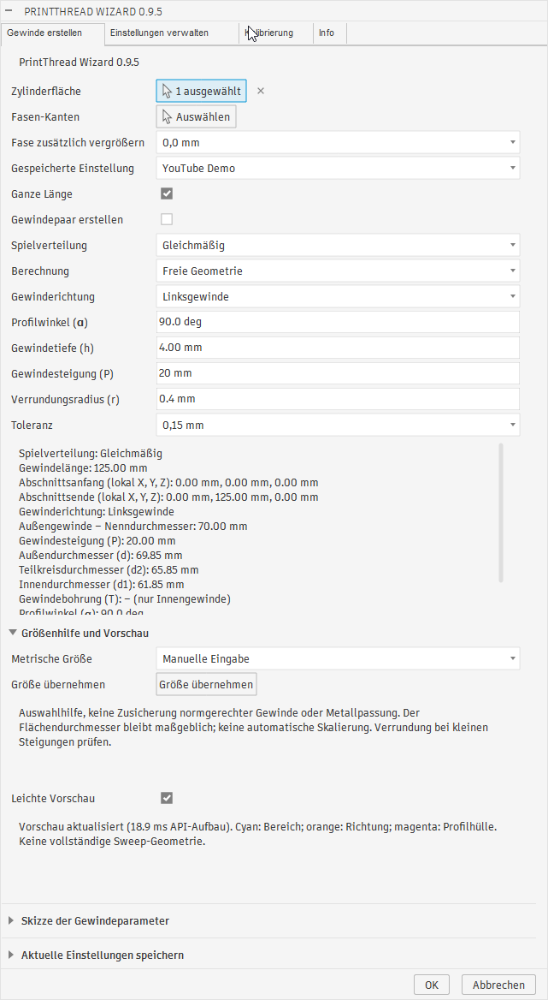

Die zugehörige Vorschau zeigt Bereich und Achse in Cyan, die kurze Helix mit
Richtungspfeil in Orange und die Profilhülle in Magenta:

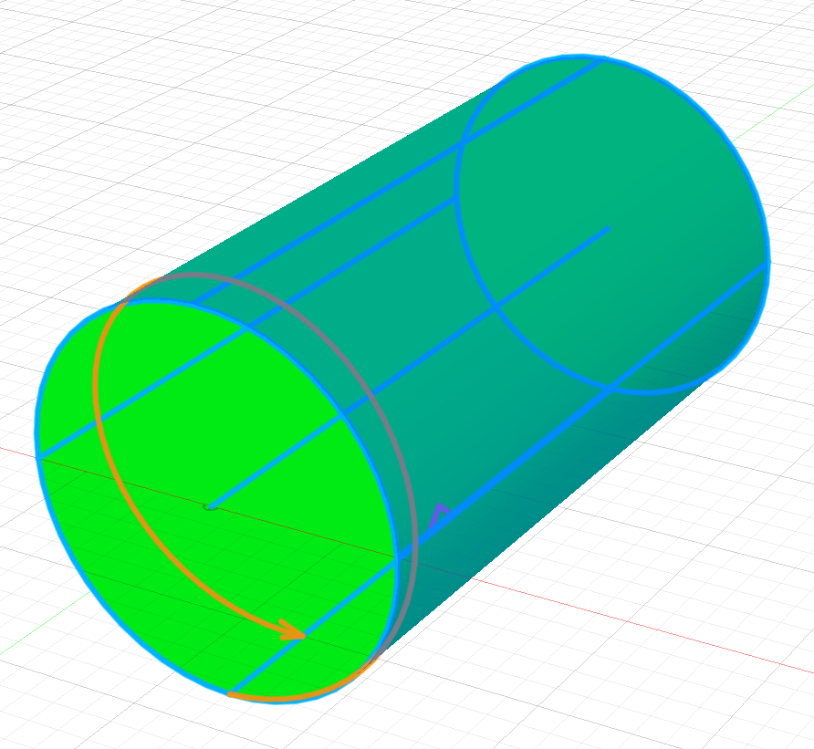

Paarweise Vorschau für Außen- und Innengewinde mit gemeinsamer Richtung
Linksgewinde und 10 mm Steigung:

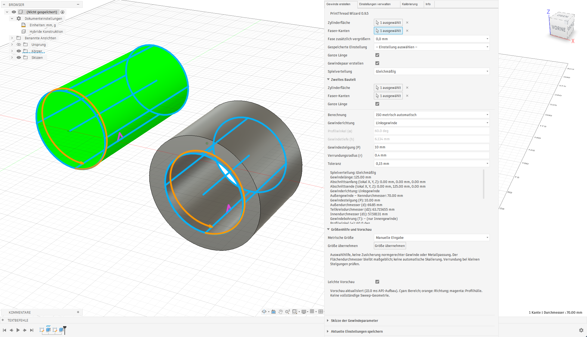

Das anschließend erzeugte Gewindepaar:

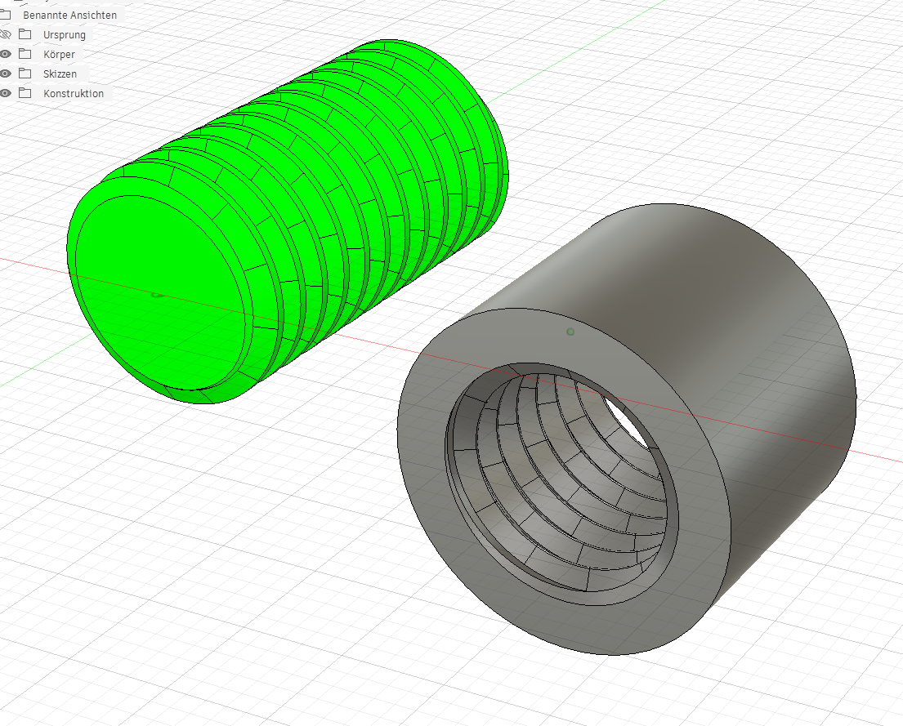

## Kalibrierungsassistent und Druckprofile

Im Reiter **Kalibrierung** Nenndurchmesser, Steigung, kurze Testlänge,
Ring-Wandstärke und Richtung einstellen. Die erste Umsetzung verwendet das
metrische 60°-Profil ohne Grundverrundung und Fasen. Die Maße sind unabhängig
vom Reiter zur Gewindeerstellung; eine Flächenauswahl ist nicht erforderlich.
Die Länge muss mindestens zwei Steigungen betragen.

**Radiales Gesamtspiel** als Liste in Millimetern eingeben, getrennt durch
Semikolon, etwa `0,10; 0,15; 0,20; 0,25; 0,30`. Punkt und Dezimalkomma sind
zulässig. **Probenreihe mit OK erzeugen** aktivieren und bestätigen. Solange
dies aktiviert ist, erzeugt OK ausschließlich die Kalibrierungsserie.
Es entsteht eine neue Komponente mit einem Referenzzapfen **REF** ohne
Spielkorrektur und bis zu zwölf Ringen **R01…** mit dem vollständigen Spiel
auf der Innenseite. Die Körper liegen nebeneinander und tragen ID und Spiel
im Namen. Es gibt keine erhabene Beschriftung auf den Passflächen: Die Ringe
im Slicer zuordnen und nach dem Druck entsprechend kennzeichnen.

Das beste gedruckte Ergebnis als **Druckprofil** speichern: Name, Drucker,
Material, Düsendurchmesser, Schichthöhe, Orientierung, Spiel, Verteilung und
Notiz. Optionale Durchmesser-/Steigungsgrenzen begrenzen die Anwendung;
`0` im Dialog bedeutet eine offene Grenze. Ein ausgewähltes Profil lässt sich
laden, als neues Profil speichern oder löschen. **Auf Gewinde anwenden**
übernimmt ausschließlich Spiel und Verteilung für die im Gewinde-Reiter
ausgewählten Flächen. Profilform, Richtung und Steigung bleiben erhalten;
Werte außerhalb der Profilgrenzen werden abgewiesen.

Die Beispielreihe ist keine garantierte Materialempfehlung. Die Kalibrierung
gilt zunächst für die getesteten Bedingungen und die Verteilung **nur innen**.
Ein Wechsel zu gleichmäßiger Verteilung oder nur außen erhält rechnerisch
das Gesamtspiel, muss aber wegen der geänderten Druckkonturen erneut geprüft
werden. Auch andere Durchmesser, Steigungen, freie Profilformen und
Druckorientierungen können ein anderes Ergebnis liefern.

Druckprofile werden getrennt von Geometrie-Presets in derselben lokalen
JSON-Datei verwaltet. Export/Import unter **Einstellungen verwalten** umfasst
beide Arten; die Erfolgszahl zählt beide. **Datenschema 2** wird beim nächsten
Speichern geschrieben. Alte Schema-1-Dateien bleiben lesbar, unbekannte
Versionen werden abgewiesen und fehlerhafte Importe verändern keine Daten.
Schema-2-Dateien erfordern Version 0.9.4 oder neuer; vor einem Downgrade die
bisherige Schema-1-Datei sichern.

Beispiel des Kalibrierungsdialogs mit geladenem Druckprofil (Version 0.9.4):

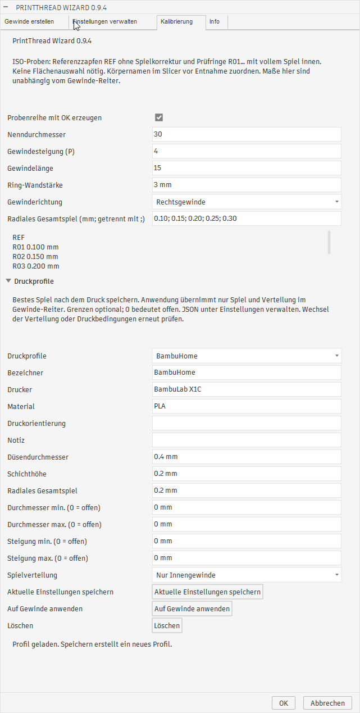

Erzeugte Kalibrierungsserie mit einem Referenzzapfen und fünf Prüfringen:

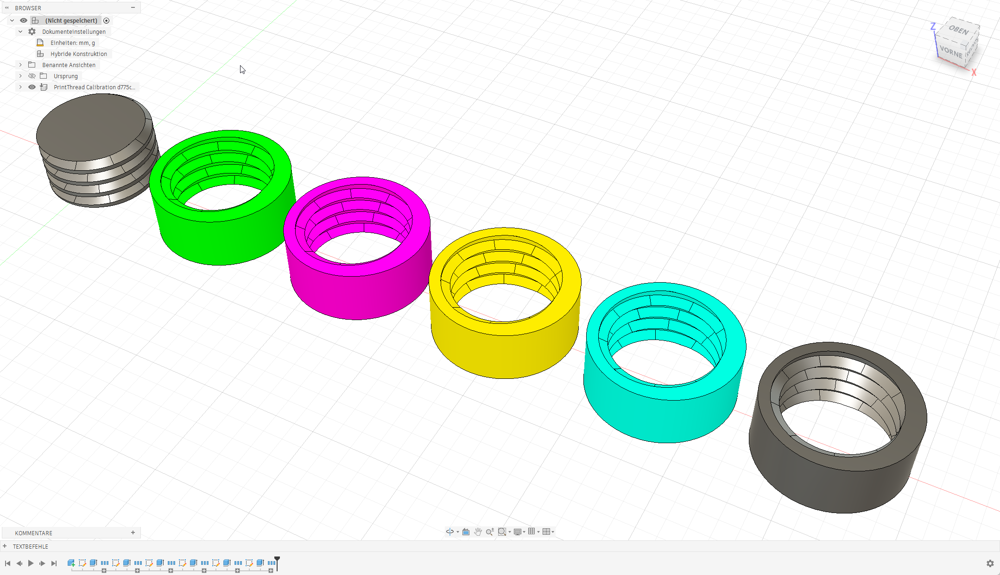

> **Entwicklungshinweis:** Dieses Add-in wurde mit Unterstützung von OpenAI
> Codex entwickelt und befindet sich weiterhin in aktiver Entwicklung.
> Funktionen, Bedienoberfläche und erzeugte Geometrie können sich noch ändern.

## Aktueller Funktionsumfang

- Automatische Übernahme der Fusion-Oberflächensprache für Deutsch, Englisch,
  Spanisch, Französisch, Italienisch und Polnisch; Englisch dient als Fallback
- Lokalisierte Validierungs- und Fehlermeldungen, Dateidialoge, Timeline-Namen
  und Dokumentation der Gewindeparameter

- Automatische Erkennung von Außenzylindern und Innenbohrungen
- Modellierte Rechts- und Linksgewinde mit exakter B-Rep-Helix und Sweep
- Ganze Zylinderlänge oder begrenzter Gewindeabschnitt mit wählbarer Startseite und axialem Versatz
- Automatischer ISO-Metrisch-Modus mit 60° Flankenwinkel und berechneter
  radialer Gewindetiefe
- Freier Geometriemodus zur manuellen Eingabe von Flankenwinkel und
  Gewindetiefe
- Einstellbare Steigung und Verrundung am Gewindegrund
- Auswählbares radiales Gesamtspiel von 0,00 bis 0,50 mm in 0,05-mm-Schritten;
  persistenter Standardwert: 0,15 mm
- Optionale Fasen an einer oder zwei ausgewählten kreisförmigen Endkanten
- Auswahl „Fase zusätzlich vergrößern“: 0,0 bis 1,0 mm in 0,1-mm-Schritten.
  Auswahlfeld und Hilfetext sind in allen sechs unterstützten Sprachen verfügbar.
- Aus dem halben Flankenwinkel abgeleiteter Fasenwinkel
- Über beide Deckflächen hinausreichende Helix für vollständige
  Gewindeanfänge und -enden
- Zusammenfassung aller erzeugten Konstruktionsschritte in der eingeklappten
  Fusion-Timeline-Gruppe `PrintThread Wizard – Gewinde`
- Ausgeblendete Dokumentationsskizze als erster Gruppeneintrag mit Gewindeart,
  Nenndurchmesser, `P`, `α`, `h`, `r`, Toleranz, `d`, `d2`, `d1`, `T` und
  Anzahl der Fasen-Kanten
- Lokales Speichern der aktuellen Gewindeeinstellungen mit Bezeichner und Notiz
- Alphabetisch sortierte Preset-Auswahl zum Übernehmen aller gespeicherten
  Gewindeparameter
- Getrennte Reiter für Gewindeerstellung einschließlich Speicherfunktion und
  Verwaltung der gespeicherten Einstellungen
- Technische Kurzzeichen und Profildarstellung für Steigung `P`,
  Außendurchmesser `d`, Teilkreisdurchmesser `d2`, Innendurchmesser `d1`,
  Gewindebohrung `T`, Profiltiefe `h` und Profilwinkel `α`
- Kompakte Preset-Tabelle mit Bezeichner, `α`, `h`, `P` und Löschaktion im
  Verwaltungs-Reiter
- Auswahl einer Tabellenzeile zeigt deren vollständige Daten und Notiz an
- JSON-Import und -Export in einem eigenen Dialogbereich mit Statusanzeige
- Eigenes Markenlogo für Fusion-Dialog, GitHub und Webseiten

## Funktionsweise der Toleranz

Die ausgewählte Toleranz bezeichnet das radiale Gesamtspiel eines passenden
Gewindepaars. In der Standardverteilung **Gleichmäßig** wird bei gleichem
Wert für Innen- und Außengewinde das Spiel auf beide Bauteile verteilt:

- Der Radius des Außengewindes wird um die halbe Toleranz verkleinert.
- Der Radius des Innengewindes wird um die halbe Toleranz vergrößert.
- Die Gewindeprofiltiefe bleibt unverändert.
- Flanken, Spitzen, Zylinderflächen und Fasen werden auf dem angepassten Radius
  erzeugt.

Bei 0,2 mm Toleranz wird beispielsweise der Außenradius um 0,1 mm verkleinert
und der Innenradius um 0,1 mm vergrößert. Der passende Wert hängt unter anderem
von Drucker, Material, Schichthöhe, Extrusionskalibrierung und Bauteilausrichtung
ab.

## Gewindepaar und Spielverteilung

**Gewindepaar erstellen** aktivieren. Die erste Zylinderfläche wie gewohnt
wählen, die zweite unter **Zweites Bauteil**. Erforderlich sind eine Außen- und
eine Innenzylinderfläche mit gleichem Nenndurchmesser auf zwei verschiedenen
Körpern. Die Körper dürfen nebeneinander liegen. Mehrere Instanzen desselben
nativen Körpers werden abgewiesen; automatische Größenänderungen erfolgen nicht.

Teilung, Richtung, Profilwinkel, Verrundung, Zusatzfase und Gesamtspiel gelten
für beide Gewinde. Im metrischen Modus werden Innen- und Außentiefe getrennt
berechnet; im freien Modus verwenden beide die eingegebene Tiefe. Unter
**Zweites Bauteil** Fasen-Kanten sowie ganze Länge oder Startseite, Versatz und
Gewindelänge unabhängig vom ersten Bauteil festlegen. Die Ergebnisanzeige
enthält beide Abschnitte. Schlägt die Erstellung eines Gewindes fehl, wird die
gesamte Paarerstellung über die Fusion-Befehlstransaktion zurückgenommen;
die praktische Fehler-/Undo-Prüfung bleibt offen.

**Spielverteilung** gilt auch beim Erstellen eines einzelnen Gewindes:

| Verteilung | Außenradius bei 0,20 mm Gesamtspiel | Innenradius bei 0,20 mm Gesamtspiel |
| --- | --- | --- |
| Gleichmäßig (Standard) | −0,10 mm | +0,10 mm |
| Nur Innengewinde | unverändert | +0,20 mm |
| Nur Außengewinde | −0,20 mm | unverändert |

Die radiale Differenz beträgt in allen Fällen 0,20 mm. Das ist keine Angabe
zur Durchmesseränderung. Presets und JSON speichern Paarmodus, Spielverteilung
und beide Längeneinstellungen; Flächen und Kanten müssen am Modell gewählt
werden. Alte Presets verwenden Einzelgewinde, ganze Länge und gleichmäßige
Verteilung. Presets mit Paarmodus oder einseitiger Spielverteilung nur mit
**0.9.3 oder neuer** verwenden: Frühere Versionen ignorieren diese Felder.

### Beispiel: Gewindepaar erstellen

Der Dialog zeigt den ausgewählten Außenzylinder und die Innenbohrung,
getrennte Längeneinstellungen für beide Bauteile und die gleichmäßige
Spielverteilung.

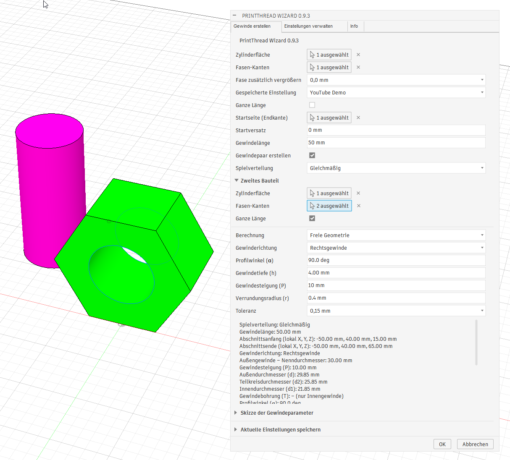

Das gemeinsam erzeugte Außen- und Innengewinde mit freier Geometrie,
90° Profilwinkel und 10 mm Steigung:

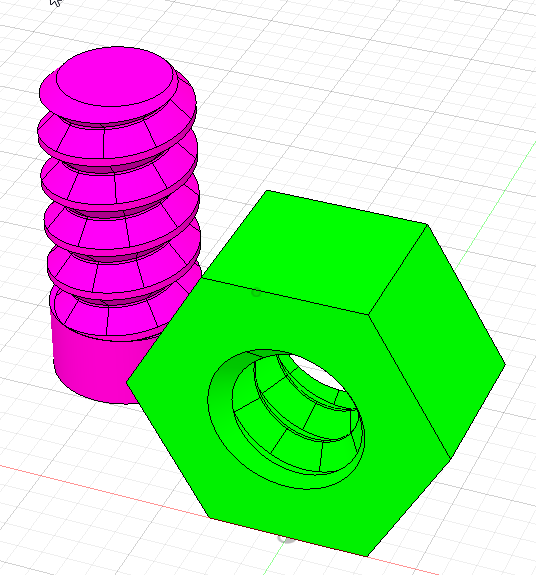

## Zusätzliche Fasengröße

**Fase zusätzlich vergrößern** erweitert die standardmäßig erzeugte Fase an den
ausgewählten Endkanten radial. Beispielsweise addiert **0,4 mm** zur bisherigen
radialen Fasengröße weitere 0,4 mm. Die axiale Tiefe wächst entsprechend dem
Profilwinkel mit. Außenfasen werden nach innen erweitert; bei Innengewinden
wird die Öffnung nach außen erweitert. Der Wert gilt für beide ausgewählten
Kanten und hat ohne ausgewählte Fasen-Kanten keine Wirkung.

Standard ist **0,0 mm**, wodurch die bisherige Fasengröße erhalten bleibt.
Der Wert wird mit den Gewindeeinstellungen gespeichert und wiederhergestellt,
auch beim JSON-Export und -Import. Ältere Einstellungen ohne diesen Parameter
verwenden 0,0 mm.

## Bilder

### Gewinderichtungen im Vergleich

Außengewinde mit entgegengesetzten Gewinderichtungen und einem gewindefreien
Abschnitt am Fuß:

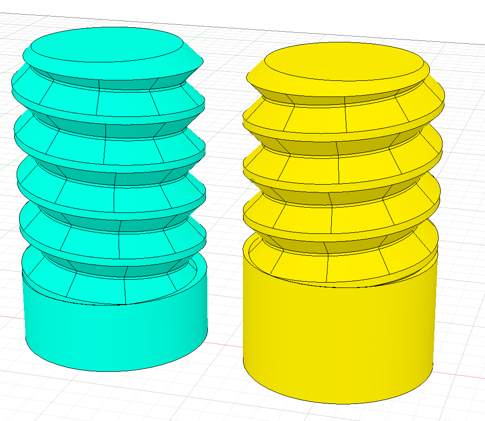

### Weitere Beispiele

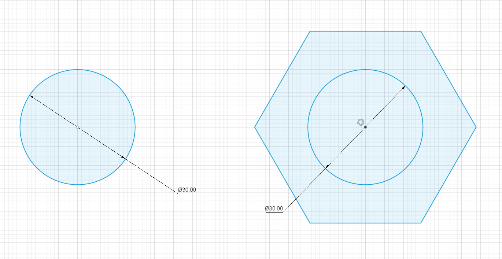

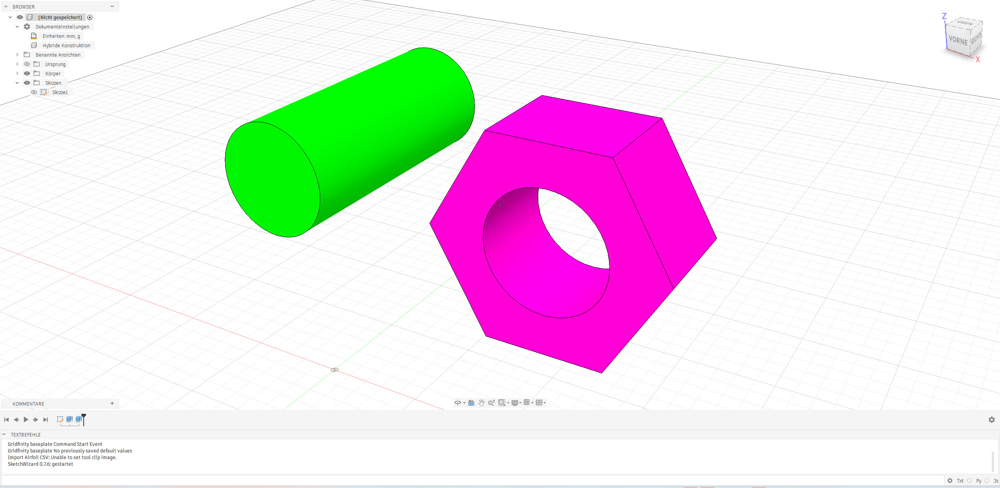

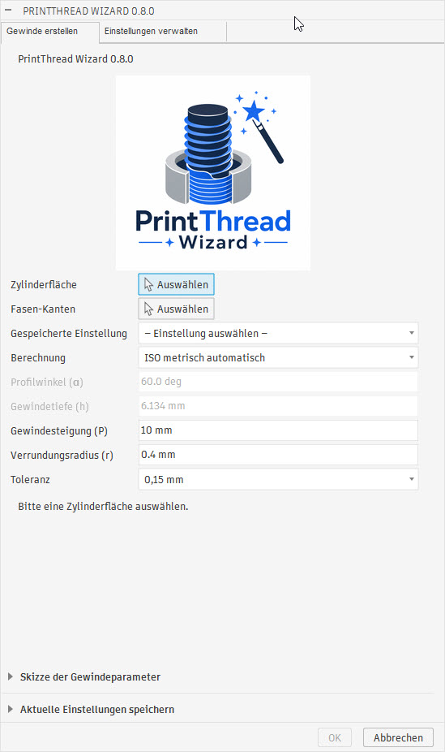

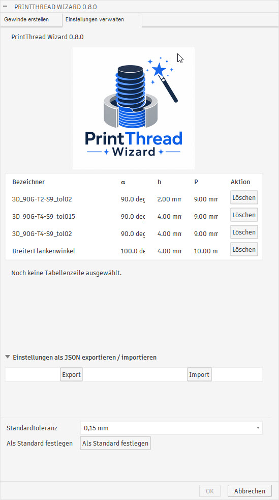

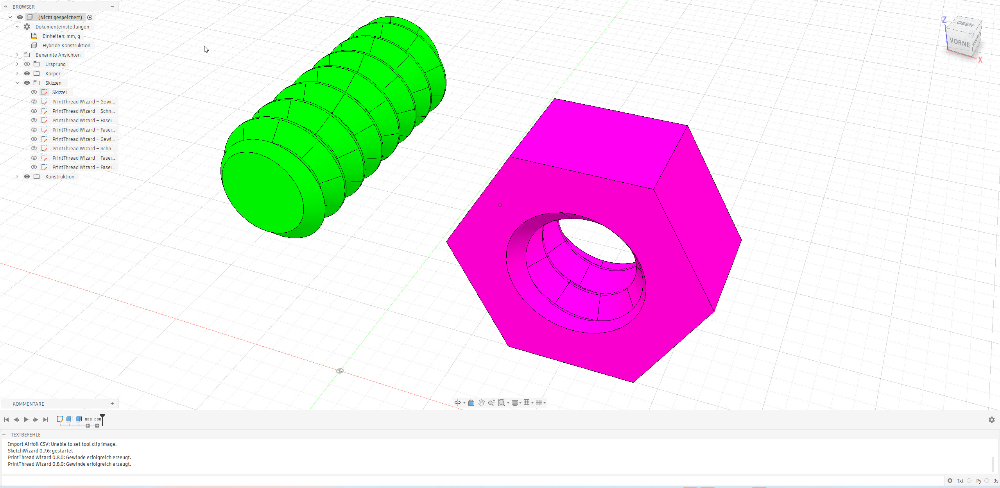

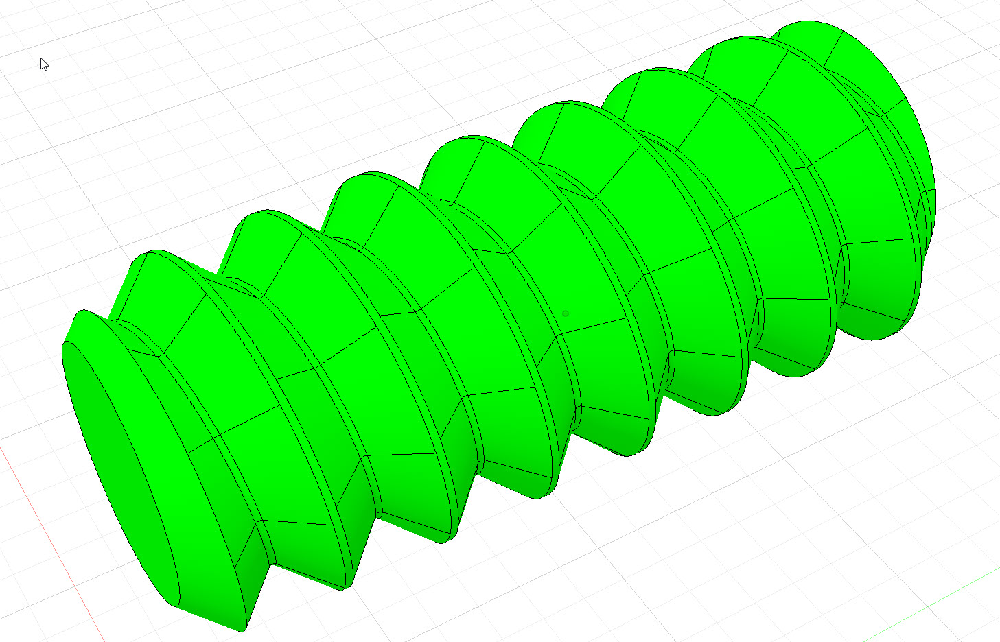

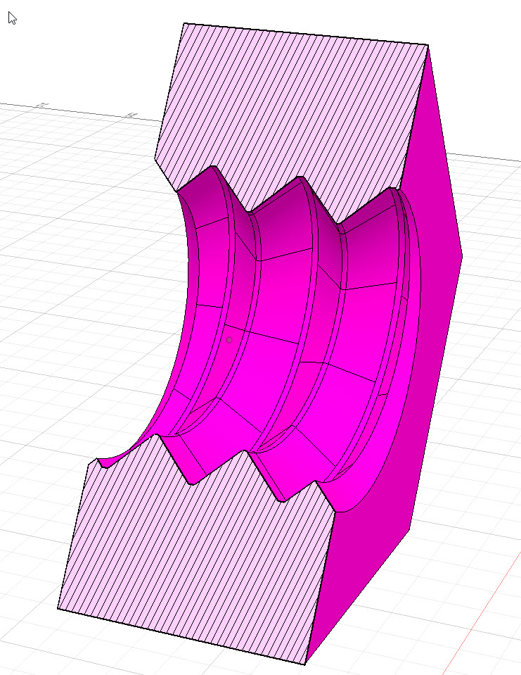

## Installation

Ausführliche Anleitung einschließlich Pfadauswahl, Updates und Fehlerbehebung:
[Installationsanleitung](doku/installation.md).

### Windows mit Installer

1. `PrintThreadWizard_Setup_0.9.4.exe` aus den GitHub-Releases herunterladen.
2. Den Installer ausführen. Er kopiert das Add-in in den Add-ins-Ordner des
   aktuellen Windows-Benutzers; Administratorrechte sind nicht erforderlich.
   Den vorgeschlagenen Zielordner mit **Voreinstellungen > API** in Fusion
   vergleichen: Ziel ist der dort angegebene Pfad plus `AddIns\PrintThread Wizard`.
   Der Installer berücksichtigt `Autodesk Fusion` und `Autodesk Fusion 360`;
   bei mehreren oder fehlenden API-Ordnern muss der passende Pfad gewählt werden.
3. Fusion neu starten oder unter **Dienstprogramme > Zusatzmodule > Skripte
   und Zusatzmodule** den Eintrag **PrintThread Wizard** starten.
4. Bei Bedarf den automatischen Start aktivieren.

### Manuelle Installation unter Windows

Alternativ das Repository herunterladen und den vollständigen Ordner
`Fusion_AddIn/PrintThread Wizard` in den Unterordner `AddIns` des unter
**Voreinstellungen > API** eingestellten Pfades kopieren, beispielsweise nach
`%APPDATA%\Autodesk\Autodesk Fusion 360\API\AddIns\PrintThread Wizard`.
Danach Fusion neu starten oder das Add-in über **Skripte und Zusatzmodule**
hinzufügen und starten.

### Manuelle Installation unter macOS

Für macOS steht derzeit kein Installer zur Verfügung. Den vollständigen Ordner
`Fusion_AddIn/PrintThread Wizard` im Finder in den Unterordner `AddIns` des unter
**Voreinstellungen > API** eingestellten Pfades kopieren, beispielsweise nach
`~/Library/Application Support/Autodesk/Autodesk Fusion 360/API/AddIns/PrintThread Wizard`.
Der Benutzerordner `Library` ist normalerweise ausgeblendet; im
Finder lässt er sich über **Gehe zu** bei gedrückter **Wahltaste (⌥)** öffnen.
Anschließend Fusion neu starten und das Add-in unter **Skripte und
Zusatzmodule** starten.

Die [macOS-Schritt-für-Schritt-Anleitung](doku/installation.md#macos) beschreibt
das Entpacken, die Pfadauswahl im Finder und die Aktivierung in Fusion.

> **Hinweis zu macOS:** Ich kann die Installation und Funktion unter macOS nicht
> selbst testen, da mir kein Mac zur Verfügung steht. Rückmeldungen von
> Mac-Nutzern sind deshalb willkommen.

Der Befehl wird im Arbeitsbereich **Konstruktion** unter
**Volumenkörper > Erstellen** eingefügt.

## Bedienung

1. Einen zylindrischen Zapfen für ein Außengewinde oder eine zylindrische
   Bohrung für ein Innengewinde vorbereiten. Der ausgewählte Durchmesser wird
   als Gewinde-Nenndurchmesser verwendet, beispielsweise 50 mm für eine
   M50-ähnliche Geometrie.
2. **PrintThread Wizard** starten.
3. Die Zylinderfläche auswählen.
4. Optional eine oder beide kreisförmigen Endkanten für die Fasen auswählen.
5. Optional eine gespeicherte Einstellung auswählen oder **ISO metrisch
   automatisch** beziehungsweise **Freie Geometrie** manuell auswählen.
6. Die Steigung sowie im freien Modus Flankenwinkel und Gewindetiefe eingeben.
7. Toleranz auswählen und Verrundungsradius festlegen.
   Bei ausgewählten Fasen-Kanten **Fase zusätzlich vergrößern** einstellen,
   beispielsweise **0,4 mm** für eine zusätzliche radiale Vergrößerung um 0,4 mm.
8. Optional einen Gewindebezeichner und eine kurze Notiz eintragen und die
   aktuellen Einstellungen über **Aktuelle Einstellungen speichern** ablegen.
9. Die berechneten Werte im Ergebnisfeld prüfen und den Befehl bestätigen.

Für ein zusammengehöriges Gewindepaar müssen Nenndurchmesser, Steigung,
Flankengeometrie und Toleranz bei beiden Bauteilen gleich eingestellt werden.

## Dialogparameter

Für ein Teilgewinde **Ganze Länge** deaktivieren. Unter **Startseite (Endkante)**
eine kreisförmige Endkante der ausgewählten Zylinderfläche wählen. Die andere
Endkante kehrt die Startseite um. Beispiel: Auf einem 40 mm langen Zylinder
**2 mm Startversatz** und **15 mm Gewindelänge** einstellen. Der Versatz wird
von der gewählten Seite in den Zylinder hinein gemessen. Die Ergebnisanzeige
zeigt Länge und Abschnittsgrenzen in lokalen Komponentenkoordinaten.

Spielkorrektur und Gewinde werden auf diesen Abschnitt begrenzt. Die übrige
Zylinderfläche bleibt erhalten. Fasen sind nur an ausgewählten echten Endkanten
zulässig, die der Gewindeabschnitt erreicht; sie müssen in den Abschnitt passen.
Bei 2 mm Abstand vom Startende kann dort daher keine Fase gewählt werden.
Künstliche Abschnittsgrenzen erhalten keine automatische Fase.

Dieselbe Endkante kann sowohl unter **Fasen-Kanten** als auch unter
**Startseite (Endkante)** ausgewählt werden. Eine zuvor für die Fase gewählte
Kante bleibt als Startseite auswählbar; die Auswahlfelder sind unabhängig.
Für eine Fase am Startende den **Startversatz auf 0 mm** setzen.
Vom Anwender in Fusion bestanden: 40 mm Zylinder mit 2 mm Versatz und 15 mm
Gewindelänge; beide Startseiten; dieselbe Kante für Fase und Startseite in
beiden Auswahlreihenfolgen; ganze Länge und alte Presets; Versatz 0, Bereiche
bis zum Ende und sehr kurze/lange Bereiche; Fasen mit 0/1/2 Kanten und Zusatzfase.
Die übrigen Fälle im [Prüfprotokoll](doku/pruefprotokoll-0.9.2.md) bleiben offen.

Längenmodus, Versatz und Gewindelänge werden in Presets und JSON gespeichert.
Die Startkante ist ein Modellbezug und muss am jeweiligen Bauteil gewählt werden.
Alte Presets ohne diese Felder verwenden weiterhin die ganze Länge. Teilgewinde-
Presets nur mit Version 0.9.2 oder neuer verwenden.

| Parameter | Beschreibung |
| --- | --- |
| Zylinderfläche | Zielfläche; Innen-/Außengewinde wird automatisch erkannt |
| Fasen-Kanten | Optionale Auswahl von bis zu zwei kreisförmigen Endkanten |
| Fase zusätzlich vergrößern | Zusätzliche radiale Vergrößerung an den ausgewählten Kanten: 0,0–1,0 mm in 0,1-mm-Schritten; Standard 0,0 mm |
| Gespeicherte Einstellung | Alphabetisch sortierte Preset-Auswahl; übernimmt alle Parameter |
| Berechnung | ISO metrisch automatisch oder freie Geometrie |
| Gewinderichtung | Rechtsgewinde (Standard) oder Linksgewinde; beide Partner müssen dieselbe Richtung verwenden |
| Ganze Länge | Standard: gesamte ausgewählte Zylinderfläche bearbeiten |
| Startseite (Endkante) | Bei Teilgewinden erforderliche kreisförmige Endkante der Zielfläche |
| Startversatz | Abstand vom gewählten Ende in den Zylinder, mindestens 0 |
| Gewindelänge | Positive Abschnittslänge; Versatz plus Länge darf die Zylinderlänge nicht überschreiten |
| Profilwinkel (α) | Eingeschlossener Profilwinkel; im ISO-Modus fest 60° |
| Gewindetiefe (h) | Radiale Profiltiefe; im ISO-Modus automatisch berechnet |
| Gewindesteigung (P) | Axialer Weg pro Umdrehung |
| Verrundungsradius (r) | Rundet den scharfen Gewindegrund ab |
| Toleranz | Radiales Gesamtspiel des zusammengehörigen Gewindepaars |
| Gewindebezeichner | Name des lokal gespeicherten Parametersatzes |
| Kurze Notiz | Optionale Beschreibung mit bis zu 500 Zeichen |

Die Parametersätze werden benutzerspezifisch in der versionierten JSON-Datei
`PrintThread Wizard/thread-presets.json` im Anwendungsdatenordner des
Betriebssystems gespeichert. Modellabhängige Flächen und Kanten werden nicht
gespeichert.

Im Reiter **Einstellungen verwalten** kann die beim Öffnen des nächsten
Dialogs vorausgewählte Toleranz persistent festgelegt werden. Dort zeigt eine
scrollbare Tabelle außerdem alle gespeicherten Parametersätze mit Bezeichner,
Profilwinkel `α`, Gewindetiefe `h` und Gewindesteigung `P`. Einträge können
zeilenweise gelöscht werden.

Der Bereich **Einstellungen als JSON exportieren / importieren** sichert oder
lädt alle Presets einschließlich Standardtoleranz. Erfolg, Abbruch und Fehler
werden direkt unter den beiden Schaltflächen angezeigt.

Das Ergebnisfeld zeigt Gewindeart, Nenndurchmesser, `P`, `d`, `d2`, `d1`, `T`,
`α`, Toleranz und Berechnungsmodus. Die darunterliegende Skizze ordnet die
Kurzzeichen dem Gewindeprofil zu.

## Bekannte Einschränkungen

- Das Add-in befindet sich in Entwicklung; die erzeugte Geometrie muss vor der
  produktiven Verwendung geprüft werden.
- Derzeit werden nur Zylinderflächen unterstützt. Die Funktion der Linksgewinde wurde in Fusion bestätigt; die vollständige Prüfmatrix ist noch offen.
- Teilgewinde sind implementiert; beide Startseiten und die oben aufgeführten Fälle wurden in Fusion bestätigt. Die vollständige Prüfung der Innen-/Außengewinde und transformierter Komponenten bleibt offen. Einlauf, Auslauf und Freistich gehören nicht zu diesem Umfang.
- Die Größenhilfe enthält eine begrenzte Auswahl metrischer Kombinationen;
  weitere Größen und Steigungen lassen sich manuell eingeben.
- Toleranzwerte sind Ausgangswerte und müssen für Drucker und Material
  kalibriert werden.
- Die erzeugten Gewinde sind nicht für zertifizierte oder sicherheitskritische
  Verbindungen vorgesehen.

## Repository-Struktur

```text
Fusion_AddIn/PrintThread Wizard/
├── PrintThread Wizard.py
├── PrintThread Wizard.manifest
├── config.py
├── version.py
├── commands/
│   └── commandDialog/
├── core/
│   ├── iso_metric.py
│   └── thread_parameters.py
└── fusion/
    ├── chamfer.py
    ├── face_analysis.py
    └── thread_geometry.py
```

Der Entwicklungsverlauf ist unter
[doku/version-timeline.md](doku/version-timeline.md) dokumentiert.

## Lizenz und Haftungsausschluss

Siehe [LICENSE](LICENSE). PrintThread Wizard ist für Prototypen, Hobbyprojekte,
Vorrichtungen und andere nicht sicherheitskritische Anwendungen gedacht.
Passung, Festigkeit und Eignung gedruckter Bauteile müssen für den jeweiligen
Einsatzzweck geprüft werden.
