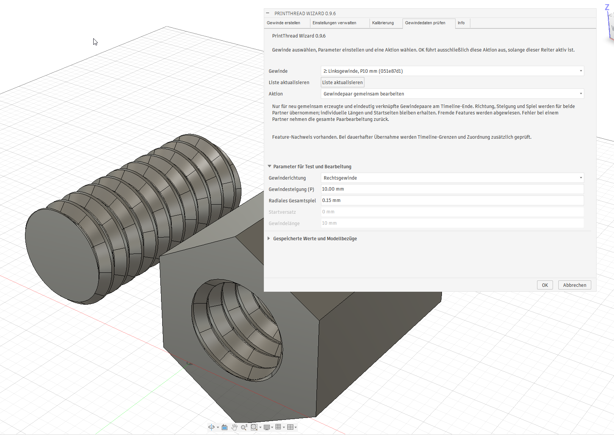

# M6 – Machbarkeitsstand 0.9.6

Stand: 29.10.2026. Erster M6-Schritt implementiert: Daten erfassen und
Bezüge prüfen. Der Machbarkeitsnachweis für einen sicheren Neuaufbau ist
noch nicht vollständig abgeschlossen. Eine begrenzte dauerhafte Bearbeitung
des letzten, vollständig zugeordneten Gewindes ist implementiert; ihre
Fusion-Abnahme bleibt offen.

## Untersuchte API und Mechanismen

Die lokal installierte Fusion-Ausgabe meldet Produktversion **2706.1.14**.
Ihre Python-API wurde auf die benötigten Schnittstellen geprüft; dies ist
kein erfolgreicher interaktiver Funktionstest.

- Attribute an Skizzen und Features speichern Daten mit dem Dokument.
- `entityToken` und `Design.findEntityByToken` dienen zum Wiederfinden von
  Entitäten. Tokenzeichenfolgen dürfen nicht als Identität verglichen werden.
  Auflösung kann mehrere Entitäten liefern, etwa nach einer Flächenteilung.
- Timeline-Objekte stellen Position und `rollTo` bereit. Die neue Prüfung liest
  Positionen; sie verschiebt den Marker nicht.
- `CustomFeatureDefinition`, Abhängigkeiten, benutzerdefinierte Parameter und
  `setStartAndEndFeatures` sind in der lokalen API vorhanden. Ein Custom Feature
  ist ein möglicher späterer Bearbeitungsmechanismus, noch keine Entscheidung
  zugunsten einer fertigen Lösung.

Primärquellen:
[Autodesk: Custom Features](https://help.autodesk.com/cloudhelp/ENU/Fusion-360-API/files/CustomFeatures_UM.htm),
[BaseFeature und Entity-Tokens](https://help.autodesk.com/cloudhelp/ENU/Fusion-360-API/files/fusion_BaseFeature.htm),
[Design](https://help.autodesk.com/cloudhelp/ENU/Fusion-360-API/files/fusion_Design.htm).

Der bestehende Generator erzeugt persistente Helix-/Führungskörper, Profil,
Sweep, Beschnitt, Spielkorrektur und gegebenenfalls Fasen. Eine Änderung der
Steigung erfordert mehr als das Ändern eines einzelnen Sweep-Parameters.
Ein kontrollierter Neuaufbau muss ursprüngliche Geometrie wiederherstellen
und danach neue Features aufbauen; abhängige spätere Features dürfen dabei
nicht versehentlich entfernt oder auf andere Flächen umgebogen werden.

## Implementierter Datenpfad

`core/thread_records.py` definiert Dokument-Metadatenschema 1 mit strikter
Versions- und Parameterprüfung, getrennt vom unveränderten Presetschema 2.
Ungültige Zahlen, unvollständige Teilgewindebezüge und unbekannte Versionen
werden abgewiesen.

`fusion/thread_records.py` erfasst ursprüngliche Modellbezüge vor dem ersten
Geometrieeingriff. Nach erfolgreicher Erzeugung werden die Daten an der
Dokumentationsskizze gespeichert und eine gemeinsame ID am Ergebnisfeature
abgelegt. Der erste und letzte Feature-Bezug werden per Token gespeichert,
nicht als dauerhaft angenommene Timeline-Indizes. Die neuen Attribute gehören
zur bestehenden Erstellungs-Transaktion; ein Fehler wird nicht verschluckt.

Alle neu erzeugten Modellgewinde, Partner und Kalibrierungsproben werden
erfasst. Alte Gewinde erhalten keine erfundenen Ursprungsdaten. Unbekannte oder
beschädigte Datensätze werden in der Liste angezeigt, ohne andere gültige
Datensätze auszublenden. Die Prüfung verwendet nur Lesezugriffe. Mehrdeutige
Bezüge werden niemals automatisch auf den ersten Treffer reduziert.

## Nächster Machbarkeitsschritt in Fusion

Die Prüfroutine für Schritt 2 ist jetzt als **Ursprungsbezüge mit OK prüfen**
implementiert. Auswahl eines Datensatzes und Aktivieren dieser Option machen
OK zur ausschließlichen Testaktion. Der Test läuft innerhalb der Execute-
Transaktion, öffnet gegebenenfalls zugeklappte Timeline-Gruppen und rollt vor
das erste Erzeugungsfeature. Nur eindeutig aufgelöste Bezüge werden an die
bestehende Parameter-/Bereichsvalidierung übergeben. Im finally-Pfad werden
Gruppenansicht und ursprünglicher Marker wiederhergestellt. Es entstehen keine
neuen Features. Eine fehlgeschlagene Wiederherstellung führt zum Abbruch der
gesamten Befehls-Transaktion. Der Anwender bestätigt den erfolgreichen Test
für Komponente, Zielkörper, ursprüngliche Fläche und Parameter sowie die
Wiederherstellung der Timeline. Weitere Bezugsvarianten bleiben offen.

Für Schritt 3 ist **Neuaufbau mit OK testen und zurücknehmen** implementiert:
Während der Execute-Transaktion vor die erste alte Erzeugung rollen und den
vorhandenen Generator mit unveränderten Parametern ausführen. Die alten
Features werden dabei nicht gelöscht. Die automatische Timeline-Gruppierung
ist für diese Einfügung deaktiviert, damit keine nachfolgenden ursprünglichen
Features in eine neue Gruppe geraten. Anschließend wird executeFailed auch
nach erfolgreicher Erzeugung gesetzt. Fusion muss dadurch alle temporären
Geometrie- und Metadatenänderungen zurücknehmen. Es wird nicht zum Timeline-Ende
gerollt, um die alten späteren Features nicht am temporär veränderten Körper
auszuwerten. Die Gruppenansicht wird vor der Rücknahme zurückgestellt.

Dieser Test beweist noch keinen sicheren Austausch alter Features oder Erhalt
nachgelagerter Referenzen. Optional lassen sich jetzt im Test Spiel und Steigung
ändern; gespeicherte Teilgewinde erlauben auch Versatz und Länge bei gleicher
Startkante. Die Anpassung erfolgt mit unveränderlichen Parameterobjekten,
ohne den Datensatz zu verändern. Im metrischen Modus wird die Tiefe mit der
tatsächlichen Innen-/Außenart des Ursprungskörpers neu berechnet. Der geänderte
Abschnitt wird am wiederhergestellten Originalkörper geprüft. Es bleibt bei
einem ausschließlich temporären Test mit obligatorischer Rücknahme. Die
dauerhafte Übernahme einer Bearbeitung ist nun in einer begrenzten Form
implementiert, wie nachfolgend beschrieben.

## Begrenzte dauerhafte Übernahme

Die Parameteränderungen umfassen inzwischen auch die Gewinderichtung. Diese
wird wie die übrigen Parameter validiert, an den bestehenden Generator
übergeben und in neuen Metadaten gespeichert. Der kompakte Dialog verwendet
ein einziges Aktionsmenü. Die dauerhafte Bearbeitung bleibt trotz dieser
Oberflächenänderung denselben Ownership- und Timeline-Prüfungen unterworfen.

Neue Erzeugungen mit dieser aktualisierten Fassung erhalten zusätzlich eine
vollständige Feature-Tokenliste und ein Ownership-ID-Attribut an jedem Feature.
Das Dokument-Metadatenschema bleibt 1; das optionale Feld ist validiert.
Vorhandene Datensätze ohne diese Liste bleiben lesbar und testbar, werden
aber nicht automatisch zur Bearbeitung freigegeben.

Die Aktion **Bearbeitung mit OK dauerhaft übernehmen** ist ausschließlich für
das letzte Gewinde vorgesehen. Der Marker muss vor dem Start am Timeline-Ende
stehen. Nach Aufklappen der ursprünglichen Gruppen müssen alle aufgelösten,
per ID zugeordneten Features lückenlos genau den Bereich vom ersten
Erzeugungsfeature bis zum Timeline-Ende abdecken. Ergebnisfeature und letzte
Position müssen übereinstimmen. Spätere oder eingeschobene fremde Features
führen vor der Entfernung zum Abbruch.

Erst nach erfolgreicher Bezugs- und Parametervalidierung wird dieser geprüfte
Bereich mit `deleteAllAfterMarker` entfernt. Danach werden ursprüngliche
Fläche/Kanten erneut aufgelöst und validiert, bevor der Generator läuft.
Bei Erfolg entstehen neue Parameterdaten und Ownership-Attribute. Bei jedem
Fehler setzt der Execute-Handler executeFailed, damit Fusion auch die
Entfernung der alten Features zurücknimmt. Es wird keine Bearbeitung mit
späteren abhängigen Features angeboten; ein Custom Feature ist für diese
begrenzte erste Umsetzung nicht erforderlich.

Der tatsächliche Commit, der Fehlerpfad nach Entfernung, Undo/Redo und die
erneute Bearbeitung nach Speichern/Öffnen müssen in Fusion geprüft werden.

## Stabile Identität und gemeinsame Paarbearbeitung

Aktueller Dialog mit gemeinsamer Paaraktion und eingeklappter Bezugsprüfung:

Die Auswahl bezeichnet ein gespeichertes Linksgewinde; im Parameterbereich
ist Rechtsgewinde als Ziel eingestellt. Das Bild zeigt den Dialog vor dem
Bestätigen und ist kein eigener Nachweis für Undo/Redo oder Dateipersistenz.

Dauerhafte Bearbeitung übernimmt jetzt die vorhandene Gewinde-ID in den neuen
Datensatz und alle Ownership-Attribute. Neue Paare erhalten zusätzlich eine
gemeinsame Paar-ID und gegenseitige Partner-IDs. Diese optionalen Metadaten
werden validiert; Dokument-Metadatenschema 1 und Presetschema 2 bleiben erhalten.
Ältere Datensätze bleiben lesbar, erhalten aber keine abgeleitete Paarzuordnung.
Einzelbearbeitung eines verknüpften Partners erhält dessen ID und damit den
gegenseitigen Link, auch wenn die Parameter danach vorübergehend nicht passen.

Die neue Aktion **Gewindepaar gemeinsam bearbeiten** verlangt eine eindeutige,
gegenseitige Zuordnung. Beide Ownership-Listen müssen zusammen lückenlos den
finalen Timeline-Bereich abdecken, ohne fremde oder spätere Features. Nach dem
Rollen vor den früheren Partner werden beide Ursprungskörper/-bezüge und die
gemeinsamen Parameter geprüft. Erst dann wird der geprüfte Bereich entfernt.
Danach werden beide Partner in ihrer ursprünglichen Reihenfolge neu erzeugt,
mit ihren stabilen IDs und Paarlinks. Richtung, Steigung und Spiel stammen aus
der gemeinsamen Eingabe; individuelle Längen, Startkanten und Fasen bleiben je
Partner erhalten. Die bisherige Spielverteilung muss bei beiden übereinstimmen.
Metrische Innen-/Außentiefe wird pro Partner abgeleitet.

Alle Arbeiten laufen in einem Execute-Befehl. Ein Fehler nach der ersten
Ersetzung erreicht executeFailed und fordert die Rücknahme beider Ersetzungen
einschließlich ihrer Metadaten an. Automatische Grenztests decken diesen Pfad ab;
echtes Fusion-Rollback, Dateipersistenz und Undo/Redo müssen separat geprüft
werden. Ein Nachweis zur Bearbeitung beliebiger später abhängiger Features
ergibt sich daraus nicht.

1. Neues Gewinde erzeugen, speichern, schließen und öffnen. Parameter und
   Ergebnisbezüge müssen erhalten sein.
2. An einem separaten Testdokument nachweisen, dass ursprüngliche Fläche und
   Kanten beim Rollen vor die erste Erzeugung wieder eindeutig gefunden werden.
   Danach die ursprüngliche Markerposition wiederherstellen.
3. Einen begrenzten Neuaufbau im Command-Transaktionsmodell erproben und einen
   absichtlichen Fehler auslösen: altes Gewinde muss erhalten bleiben.
4. Erst nach diesem Nachweis einen Bearbeitungsdialog und gegebenenfalls einen
   Custom-Feature-Mechanismus integrieren. Paare, Fasen, Komponenteninstanzen,
   nachfolgende Features und Undo/Redo benötigen eigene Referenzfälle.

Der Reiter heißt deshalb **Gewindedaten prüfen**, nicht „Gewinde bearbeiten“.
Ein Datensatz oder erfolgreich aufgelöster Token allein kennzeichnet noch kein
sicher bearbeitbares Gewinde.
